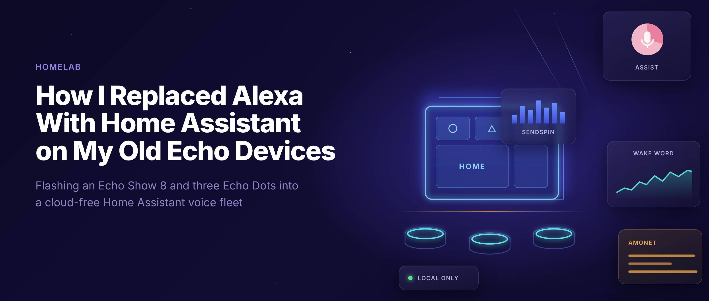
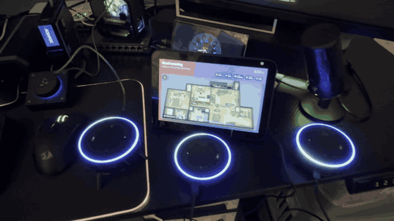
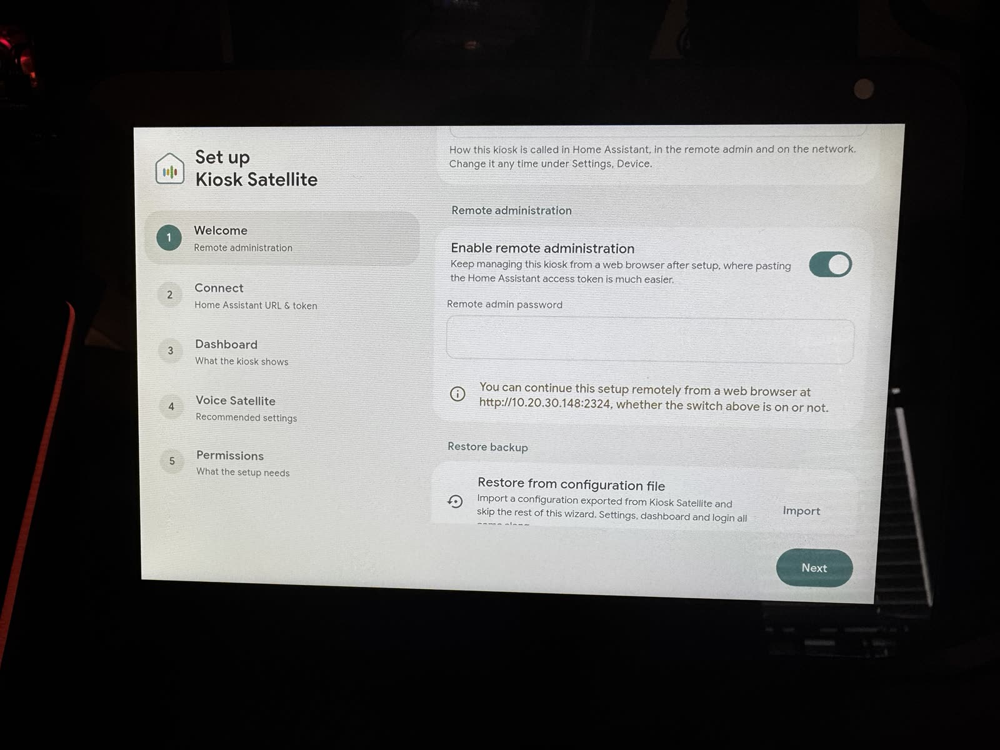

# How I Replaced Alexa With Home Assistant on My Old Echo Devices

Flashing an Echo Show 8 and three Echo Dots into a cloud-free Home Assistant voice fleet.

Notes and checks from flashing an Echo Show 8 (1st gen) and three Echo Dots (2nd gen) with LineageOS and [Kiosk Satellite](https://github.com/jxlarrea/kiosk-satellite), so they work as local Home Assistant voice satellites with no Alexa and no Amazon account.

The full write-up is on Medium and Substack: *[links]*

> **Warning:** Unlocking and flashing erase the device. There is no supported way back to Alexa, and a wrong file or an interrupted flash can brick it. You do this at your own risk.

## The fleet

| Device | Model | Codename | Role | Image |
| --- | --- | --- | --- | --- |
| Echo Show 8 (1st gen, 2019) | C7H6N3 | crown | Fleet lead: dashboard, Now Playing, voice | lineageos-echo-kiosk-satellite 2026.11.5 |
| Echo Dot (2nd gen, 2016) x3 | RS03QR | biscuit | Room satellites: voice, speaker, intercom | lineageos-echo-kiosk-satellite 2026.11.4 |

Other generations are not supported. The 2nd- and 3rd-gen Echo Show 8 use chips this exploit doesn't work on.

## Order of work

1. [Prepare a Linux host](docs/01-linux-host.md)
2. [Flash the Echo Show 8](docs/02-echo-show-8.md)
3. [Flash each Echo Dot](docs/03-echo-dot-2nd-gen.md)
4. [Add the fleet to Home Assistant and Music Assistant](docs/04-home-assistant.md)
5. [Web admin and Fleet Management](docs/05-web-admin-and-fleet.md)
6. [Troubleshooting](docs/troubleshooting.md)

## What this repo does not contain

This repo has no amonet binaries, LineageOS images, Amazon firmware or Amazon wake word models. Download amonet and the images from their upstream projects:

- amonet (k4y0z and R0rt1z2): [Echo Show 8 (crown) on XDA](https://xdaforums.com/t/unlock-root-twrp-unbrick-amazon-echo-show-8-1st-gen-2019-crown.4766687/) and [Echo Dot (biscuit) on XDA](https://xdaforums.com/t/unlock-root-twrp-unbrick-amazon-echo-dot-2nd-gen-2016-biscuit.4761416/)
- Kiosk images (jxlarrea): [Echo Show 8 releases](https://github.com/jxlarrea/lineageos-echo-kiosk-satellite/releases?q=crown) and [Echo Dot releases](https://github.com/jxlarrea/lineageos-echo-kiosk-satellite/releases?q=biscuit)
- Upstream guides: [Echo Show 8 install](https://github.com/jxlarrea/lineageos-echo-kiosk-satellite/blob/main/docs/echo-show-8.md) and [Echo Dot unlocking notes](https://github.com/jxlarrea/lineageos-echo-kiosk-satellite/blob/main/docs/unlocking.md#echo-dot-2nd-gen)

## Credits

- **k4y0z and R0rt1z2:** amonet-fastbrick, the bootloader unlock
- **R0rt1z2:** the LineageOS 18.1 port for the Echo Show 8
- **jxlarrea:** Kiosk Satellite and the lineageos-echo-kiosk-satellite images

Upstream projects keep their own licenses.
