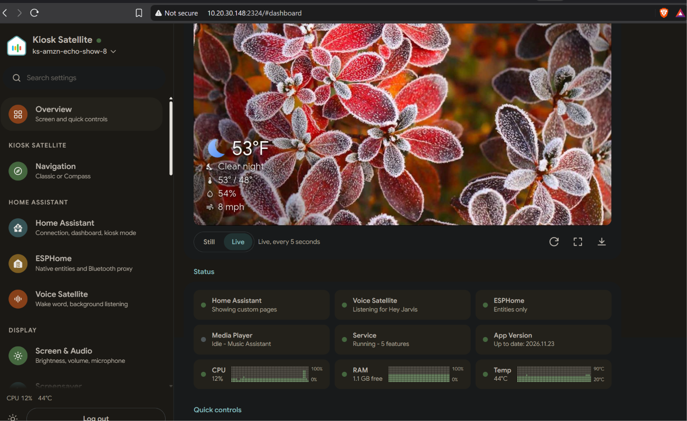
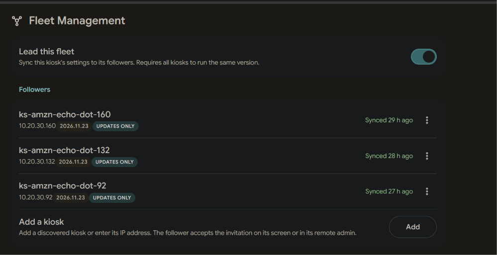

# 5. Web admin and Fleet Management

## Reach a device's web admin

Every kiosk serves its own admin page on port 2324. The Dots have no screen, so this is the only way to set them up.

1. Find the device's IP address:

   ```sh
   adb shell echo_service wifi
   ```

   on the Show, or

   ```sh
   adb shell ip -4 addr show wlan0
   ```

   on a Dot. Your router's DHCP lease list works too.

2. Open `http://<device-ip>:2324` in a browser on the same network. It's plain HTTP, so the browser shows "Not secure". Keep it on your LAN.
3. Log in with the remote admin password set in the setup wizard.

The **Overview** page shows a live screenshot (every 5 seconds) and a status grid: Home Assistant, Voice Satellite and its wake word, ESPHome, media player, service, app version, CPU, RAM and temperature.



To rename a device, use **Settings > Device**. I named mine `ks-amzn-echo-show-8` and `ks-amzn-echo-dot-<last octet of its IP>`.

## Build the fleet

One kiosk leads and the others follow its settings. All kiosks must run the same Kiosk Satellite version.

1. In the leader's web admin (the Show, in my case), open **Fleet Management** and turn on **Lead this fleet**.
2. Under **Add a kiosk**, click **Add**, then pick a discovered kiosk or enter its IP address.
3. Accept the invitation on the follower, either on its screen or in its remote admin. For the Dots, use the remote admin.

The leader lists each follower with its IP address, app version and last sync time.


