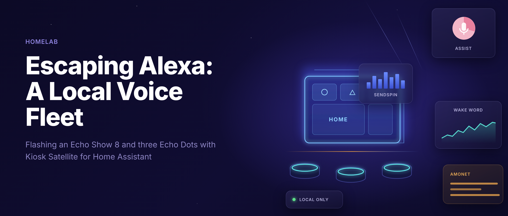

# Escaping Alexa: an Echo Show 8 and three Echo Dots as a Home Assistant voice fleet

Notes, checks and helper scripts from flashing an Echo Show 8 (1st gen) and three Echo Dots (2nd gen) with LineageOS and [Kiosk Satellite](https://github.com/jxlarrea/kiosk-satellite), so they work as local Home Assistant voice satellites with no Alexa and no Amazon account.

The full write-up is on Medium and Substack: *[links]*

> **Warning:** Unlocking and flashing erase the device. There is no supported way back to Alexa, and a wrong file or an interrupted flash can brick it. You do this at your own risk. Read [docs/legal.md](docs/legal.md) first.

## The fleet

| Device | Model | Codename | Role | Image |
| --- | --- | --- | --- | --- |
| Echo Show 8 (1st gen, 2019) | C7H6N3 | crown | Fleet lead: dashboard, Now Playing, voice | lineageos-echo-kiosk-satellite 2026.11.5 |
| Echo Dot (2nd gen, 2016) x3 | RS03QR | biscuit | Room satellites: voice, speaker, intercom | lineageos-echo-kiosk-satellite 2026.11.4 |

Other generations are not supported. The 2nd- and 3rd-gen Echo Show 8 use chips this exploit doesn't work on.

## Order of work

1. [Prepare a Linux host](docs/01-linux-host.md)
2. [Flash the Echo Show 8](docs/02-echo-show-8.md)
3. [Flash each Echo Dot](docs/03-echo-dot-2nd-gen.md)
4. [Add the fleet to Home Assistant and Music Assistant](docs/04-home-assistant.md)
5. [Troubleshooting](docs/troubleshooting.md)

## Scripts

| Script | What it does |
| --- | --- |
| `scripts/host-prep.sh` | Installs adb, fastboot and pyserial, stops ModemManager, adds the udev rule for Amazon's USB vendor ID |
| `scripts/check-recovery.sh` | Confirms the device is in TWRP recovery, prints the TWRP version and, on a Dot, the active slot |
| `scripts/install-image.sh` | Wipes and installs a kiosk image: once on the Show, on slot A then slot B on a Dot |
| `scripts/post-install.sh` | Waits for boot, sets time (Show), joins Wi-Fi and follows the Kiosk Satellite install |

Every script stops and asks before it wipes or writes anything.

## What this repo does not contain

This repo has no amonet binaries, LineageOS images, Amazon firmware or Amazon wake word models. Download amonet and the images from their upstream projects:

- amonet (k4y0z and R0rt1z2): [Echo Show 8 crown thread on XDA](https://xdaforums.com/t/unlock-root-twrp-unbrick-amazon-echo-show-8-1st-gen-2019-crown.4766687/), and the biscuit package for the Dot
- Kiosk images (jxlarrea): [lineageos-echo-kiosk-satellite releases](https://github.com/jxlarrea/lineageos-echo-kiosk-satellite/releases)

## Credits

- **k4y0z and R0rt1z2:** amonet-fastbrick, the bootloader unlock
- **R0rt1z2:** the LineageOS 18.1 port for the Echo Show 8
- **jxlarrea:** Kiosk Satellite and the lineageos-echo-kiosk-satellite images

## License

The docs and scripts in this repo are MIT licensed. See [LICENSE](LICENSE). Upstream projects keep their own licenses.
