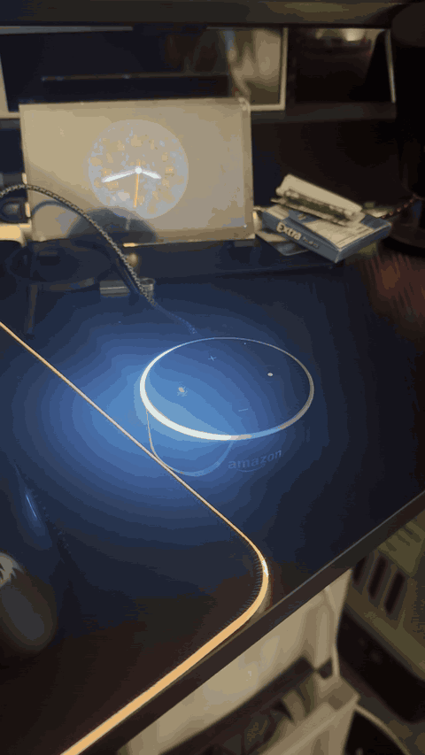

# 3. Flash an Echo Dot (2nd gen, biscuit)

Repeat this page once per Dot. The Dot has no screen, so the light ring is your status indicator. It also has two system slots, A and B, and the image goes on both.

## Before you start

- Deregister the Dot from your Amazon account.
- Download `amonet-biscuit` v2 and the newest biscuit release of [lineageos-echo-kiosk-satellite](https://github.com/jxlarrea/lineageos-echo-kiosk-satellite/releases).

## Step 1: Unlock with amonet

Put the Dot in fastboot mode: *[add the method you used]*. Connect it, then:

```sh
cd amonet-biscuit-v2.0.1/amonet
sudo ./fastbrick.sh
```

Expected detection:

```
Detected: BISCUIT - Echo Dot 2nd Generation - 2016
LK build: f379dba-20170906_000423
Will use payload: fastbrick.img
```

Type `YES`. Sending the payload "might take a few attempts". It ends with:

```
Exploit most likely successful!

Please wait until the process finishes and DO NOT INTERRUPT IT.
```

> **Warning:** The script returns before the Dot is finished. **Wait until the light ring turns white** before unplugging anything or running another command. Pulling the cable while the ring is still changing is how Dots get bricked.



## Step 2: Confirm recovery mode and the active slot

```sh
adb reboot recovery
adb devices -l
adb shell getprop ro.twrp.version
adb shell bcbtool get_active
```

| Check | Expected |
| --- | --- |
| `adb devices -l` | `recovery ... product:omni_biscuit ... device:biscuit` |
| `ro.twrp.version` | `3.7.0_9-0` |
| `bcbtool get_active` | `a` |

The Dot always boots slot A's kernel, so the first install must go to slot A. If `get_active` prints `b`:

```sh
adb shell bcbtool set_active a
adb reboot recovery
adb shell bcbtool get_active
```

`scripts/check-recovery.sh dot` runs all of these checks.

## Step 3: Install to slot A

```sh
adb shell twrp wipe cache
adb shell twrp wipe data
adb push lineageos-echo-kiosk-satellite-2026.11.4-biscuit.zip /sdcard/update.zip
adb shell twrp install /sdcard/update.zip
```

The install must end with `script succeeded: result was [1.000000]`. If not, don't reboot.

```sh
adb reboot
adb shell getprop sys.boot_completed
```

The first check may come back empty. Wait a few seconds and run it again until it prints `1`.

## Step 4: Install to slot B

The second copy is the fallback: if one slot fails, the other still boots.

```sh
adb reboot recovery
adb shell bcbtool get_active
adb shell bcbtool set_active b
adb reboot recovery
adb shell bcbtool get_active
```

The last command must print `b`. Install again **without** wiping data:

```sh
adb shell twrp install /sdcard/update.zip
adb shell rm /sdcard/update.zip
adb reboot
```

> **Tip:** If the slot B install fails, run `adb shell bcbtool set_active a` and reboot. If a Dot ever boot-loops, unplug it, hold **+** while plugging it back in to reach TWRP, set the slot that works, and reboot.

`scripts/install-image.sh dot <zip>` runs steps 3 and 4 with checks between them.

## Step 5: Wi-Fi and Kiosk Satellite

```sh
adb shell "biscuit_service wifi connect '<ssid>' '<password>'"
adb shell ip -4 addr show wlan0
adb logcat -s ks-install
```

`biscuit_service` returns a `Starting service` line without saying whether the connection worked, so check the `inet` address. The install log should show:

```
ks-install: downloading .../kiosk-satellite-<version>.armeabi-v7a.apk
ks-install: installed Kiosk Satellite
ks-install: Kiosk Satellite is the device owner
```

The Dot doesn't print `permissions granted`. The three lines above mean it finished.

> **Warning:** The Dot runs adb over Wi-Fi on port 5555 with no password. Keep it on a trusted network or an IoT VLAN.

Notes:

- The Dot can't join a WPA3-only network. Use WPA2 or WPA2/WPA3.
- It supports 5 GHz, including DFS channels 52 to 144.
- `adb devices -l` now shows `model:Echo_Dot__KS_`.
